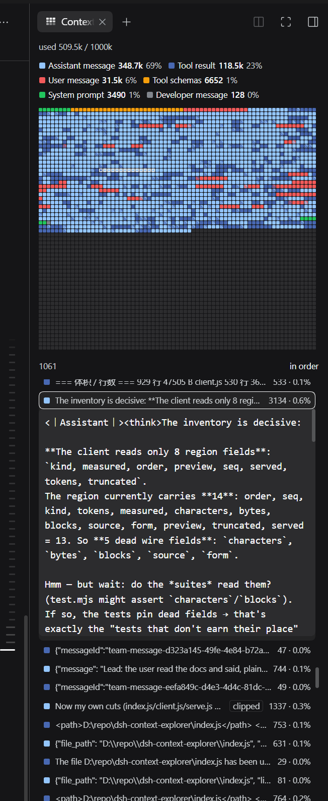
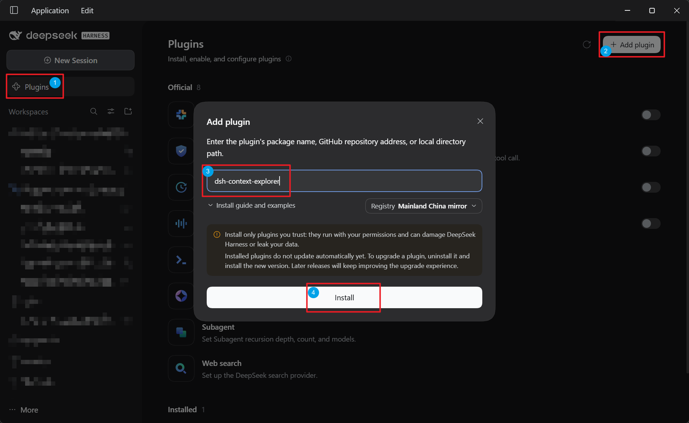

# Context Explorer

A panel for DeepSeek Harness that shows what a Session actually sends to its
model: the rendered system prompt, the tool schemas, and every message, drawn as
a grid of token squares. It appears as a tab in the Web UI's right sidebar,
titled 上下文 / Context.



One square is one slice of the context window, painted with the kind of content
holding most of it; the dark squares past the end are free space. Above the grid,
the chips are the legend and the filter; below it, every region is a row, and a
row opens the text the model receives for that region.

This is an unofficial third-party plugin, not affiliated with or endorsed by
DeepSeek. MIT licensed — see [`LICENSE`](LICENSE); [`THIRD_PARTY_NOTICES.md`](THIRD_PARTY_NOTICES.md)
records the two files reproduced from DeepSeek projects (`estimate.js`, `serve.js`).

## Install

```
dsh plugin --profile <name> add dsh-context-explorer
```



The same install is available from the Web UI's Plugins page: **Add plugin**,
then the package name, a GitHub address, or a local directory path.

`dsh plugin` forwards its arguments to pnpm in that profile, so the flag names the
profile to install into. The package declares `dsh.bundle.patch` →
`./cordis.patch.yml`, so the profile loader applies its one host row the next time
the profile loads. The runtime files are plain checked-in JavaScript with no build
step and no install script, so a `github:` install needs no build permission. Node
`^22.19.0` or `>=24.0.0`. `locale/*.json` carry the display name and description
per language (上下文浏览器 / Context Explorer). Verified against
`@deepseek-ai/dsh` 0.2.0-rc.2; the plugin declares no version gate, so a Harness
release that moves these extension points would show up as a missing or empty
panel rather than a refused install. A Host-half change needs a server restart;
the browser half reloads on its own.

## What the panel shows

**A headline.** `已用 {used} / {total}`: `used` is the prompt size the provider
reported for the last request, and until a call reports one it is the panel's own
total. `total` is the context window, or `—` when the host has no window yet. The
tooltip says which figure is which.

**Composition chips.** One per kind of content present, heaviest first: an 8×8
swatch in that kind's colour, the kind's name, its token total and its share of
the panel total. They wrap, and they double as the grid's legend. Clicking a chip
filters the list to that kind; clicking it again clears the filter.

**The grid.** The whole context window, not just the part in use, as squares each
covering an equal slice of the window. Occupied squares carry the colour of the
kind holding most of that slice; a slice with at least 35% held by a second kind is
drawn as a diagonal blend; the space past the end of the context is drawn flat as
free space. Squares are 7 device pixels on a side with a 1-pixel gap, so every
square paints the same size on any display scale. Hovering names the kind or
kinds. Clicking a square opens the region that holds most of it.

**The list.** One row per region, in the order the model sees them: colour swatch,
a one-line preview, a `已截断` / clipped badge on a closed row whose fragment was
cut, and the region's token figure with its share. A figure the provider counted is
printed bare; this plugin's estimate carries `≈`. Clicking a row opens the region's
own fragment of the prompt the model receives — role markers and all — rather than
a summary of it; the badge gives way to `detail.clippedNote` in the body, so the
fact is stated once. A count and a toggle switch the list between model order and size
order.

With nothing to draw — no published view yet, or a view with no regions — the
panel says so instead of an empty shell. A fold failure prints above the headline.
A rendering error replaces the tab rather than leaving a blank panel.

## Where the numbers come from

The headline is the provider's own count of the last request. Each region's figure
is the provider's count where one covers that region, and this plugin's estimate
otherwise — marked `≈`. Two things are measured: an answer's own size, when the
report states the output it was generated with, and a message that is the only one
in a request window, which is what the prompt grew by less the previous answer.
The system prompt, the tool envelope, a compaction summary, a window holding
several messages, and anything appended after the last report have normally no
provider count of their own, so they stay estimated.

The estimate is the Harness's own fixed heuristic, the same one its context meter
uses: one token per four UTF-16 code units, plus four per content block and four
per message. It prices content and not wire framing, and it drifts with the
language of the text, so read an estimated figure as composition, not as a bill.

## Known limitations

- **The prompt text is a reconstruction, not a capture.** The Harness talks to the
  hosted API, which renders the prompt server-side, and the session log records no
  request body. `serve.js` transcribes the published serving implementation so the
  panel can show a region in the form the model receives;
  `tools/prompt-golden.mjs` holds that transcription byte for byte against the
  official open-weights encoder. Treat it as what that implementation renders.
- **The panel shows fragments, not one continuous prompt.** Each region carries its
  own piece. Two pieces travel whole because each exists once per request: the
  hoisted system prompt (the earliest one, not the newest), whose section boundaries
  exist nowhere else, and the `## Tools` block. A message's fragment is capped at
  4000 UTF-16 code units and spent in the order the prompt spends it; a region whose
  fragment was cut is marked clipped and its expansion says only the beginning was
  kept. The row's preview is bounded separately at 400 code units.
- **Host-half changes need a server restart.** `index.js`, `serve.js` and
  `estimate.js` are read when the DSH server starts, so restart `dsh web` after
  editing them. `client.js` is served through the client module system, which
  reloads the browser half without a restart.
- **No automated visual check.** The suites cover the fold, the wire, the browser
  helpers, the packaging and the prompt text; nothing renders the panel in a
  browser, so its layout is checked by hand.

## Layout

One npm package, one plugin, both halves in it:

| Path | Role |
|---|---|
| `index.js` | Host half: the `sessionProjections` unit that folds a session into the view |
| `client.js` | Browser half: the tab, the grid, the region list |
| `serve.js` | The served-prompt renderer, transcribed from the DeepSeek serving implementation |
| `estimate.js` | The token estimator, a local copy of the shipped one |
| `package.json`, `cordis.patch.yml` | Manifest and the bundle patch (one host row) |
| `icon.svg`, `locale/*.json` | The mark, and the name and description per language |
| `docs/prompt-injection-format.md` | How a Harness conversation becomes prompt text |
| `docs/screenshots/` | The two images above, kept out of the published tarball |
| `tools/` | Checks and diagnostics |

The host half imports nothing but its sibling `estimate.js` and `serve.js`, which
is what lets a profile link this directory directly instead of installing a
published copy.

## Checks

Run from the repository root; each exits non-zero on failure.

- `node tools/check-bundle.mjs` — packaging and bindings: the manifest ships every
  runtime file, both halves resolve through it, every class the stylesheet styles is
  applied by an element, and no declaration shadows a builtin.
- `node tools/context-explorer.test.mjs` — the host fold: region order, the
  accounting behind every share, the prompt surviving a rewrite, the truncation
  flag, and agreement with the installed estimator.
- `node tools/context-explorer.contract.mjs` — the wire the two halves share:
  locale keys, the fields each half names, the grid's square budget, the palette.
- `node tools/context-explorer.helpers.test.mjs` — the browser half's pure helpers,
  loaded through its real module registration.
- `node tools/prompt-golden.mjs` — `serve.js` against the official encoder, byte
  for byte.

`tools/replay-session.mjs <session.v4.jsonl.zstd>` replays a real log, and
`tools/activation-probe.mjs` mounts the plugin as the Loader does and asserts the
projection key reaches a snapshot.
